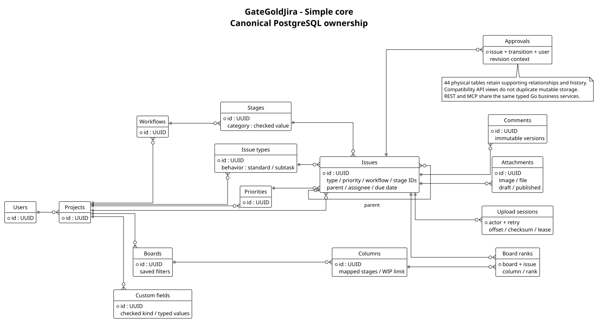

# Current GateGoldJira database

Captured from the running local database on **2026-10-14T23:28:06.086111+00:00** after verified migration **19**. The application retains **44 physical tables**, **374 columns** and **92 foreign keys**. Goose keeps one additional migration bookkeeping table. The 14 views include older API compatibility projections and planning reports. Migration 19 adds a compact partial active-stage count index without adding tables or changing original rows.

[Simple overview](current-overview.svg) · [Overview PlantUML](current-overview.puml) · [Complete diagram](current-schema.svg) · [Complete PlantUML](current-schema.puml) · [SQL schema](current-schema.sql) · [Structural catalog](schema-catalog.json)

## The main model

| Area | Storage and purpose |
|---|---|
| Identity and access | Users, identities, projects and memberships retain company/project roles. |
| Issue configuration | Workflows, stages, transitions, issue types, priorities and type/workflow bindings hold scoped choices. |
| Issues | `issue_records` stores typed choice IDs, assignee, parent, dates and current content. Labels, dependencies, watchers and related-issue links remain explicit relationships. |
| Boards | `board_records`, columns, stage mappings and board/issue ranks support independent layouts, ordering and WIP rules. |
| Rich text and files | Comments retain immutable versions. One `attachments` table owns images and documents; one `upload_reservations` table owns recoverable upload sessions. Files stay in private object storage. |
| Extensions | Typed field definitions/options/values and contextual approvals extend issues without adding arbitrary unvalidated data to core rows. |
| Supporting features | Planning, imports, development links, assignment rules, notifications, activity and retry receipts retain their own constraints and history. |

Old relation names such as `issues`, `boards` and `pictures` are compatibility views. They map supported old requests to the same canonical owners; they do not maintain separate mutable copies. Issue type/priority/stage strings, shared issue rank and embedded board workflow are no longer independent current state. Original migration ranks and workflow snapshots remain immutable migration evidence.

The database uses scoped foreign keys and checked values. Go services add current authorization, dependency-cycle prevention, workflow transitions, WIP capacity guards, approval context and completion rules. REST and MCP call the same services. Angular remains a separate, strictly typed frontend.

## Verified adoption and measured capacity

All 44 original table projections matched exactly during backed-up adoption of migration 18 → 19. The fresh paired database/files backup restored into isolated local targets: all original projections, 15 object files, four published assets' sizes/hashes/generations and all 16 prior accepted receipts passed. The existing project retains its current client mode; an administrator can explicitly review and activate new issue mode in Project → Issue configuration. Canonical storage serves both presentations.

The complete Go/PostgreSQL race suite and vet, generated-contract/architecture checks, strict Angular compilation, 105 unit tests, production build and all 153 browser cases passed. Native bulk editing, saved searches and guarded activation are included. [Final verification](../../specs/002-scalable-core/validation/final-verification.md) records the results and inspection limits.

The repeated 200k-issue/100-active-user local workload now meets the unchanged 500 ms read and 750 ms save p95 targets with zero failed operations. Board p95 was 455.40 and 405.00 ms in two runs, improved from the retained approximately 630 ms failed baseline. Exact same-snapshot counting uses the compact `(project_id,stage_id)` partial index rather than scanning all active issue rows. [Current performance evidence](../../specs/002-scalable-core/validation/modern-completion-performance.md) retains actual query plans and measurements. Warm local results do not establish hosted or unlimited capacity.

Google/Auth0 authentication, real GCS, Cloud Run/Cloud SQL performance and an external paired restore drill remain [pending acceptance](../../specs/002-scalable-core/validation/readiness.md).

## Earlier design artifacts

The `proposed-*` files are historical V1/V2 design and review artifacts. Use the `current-*` files above for the actually adopted schema. [Original V2 review](proposed-v2-review.txt) documents the design rationale; the current catalog is authoritative for physical names and constraints.

Regenerate the structural snapshot with `python3 scripts/capture-database-schema.py --database gategoldjira --output docs/database` from the project root. This captures schema definitions only; it does not export company rows or credentials.
